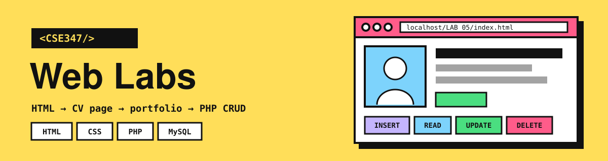

  

# 🌐 CSE347 · Web Labs

Lab work for **CSE347**, going from plain HTML to a database-backed PHP app.

| Lab | What it builds | Tech |
|---|---|---|
| [LAB 01](LAB%2001/) | First HTML page | HTML |
| [LAB 02](LAB%2002/) | Personal CV page | HTML |
| [LAB 03](LAB%2003/) | Multi-page portfolio: home, education, skills, projects, interests, contact | HTML, CSS |
| [LAB 05](LAB%2005/) | User management app with **create / read / update / delete** | PHP, MySQL |

## Run

**LAB 01–03:** open the `.html` files in a browser.

**LAB 05 (PHP CRUD):**

1. Install a local PHP + MySQL stack such as XAMPP, WAMP or Laragon.
2. Import [`LAB 05/sql.sql`](LAB%2005/sql.sql) to create the `user_management` database.
3. Copy `LAB 05/` into your web root (for example `htdocs/`) and open `http://localhost/LAB%2005/`.
